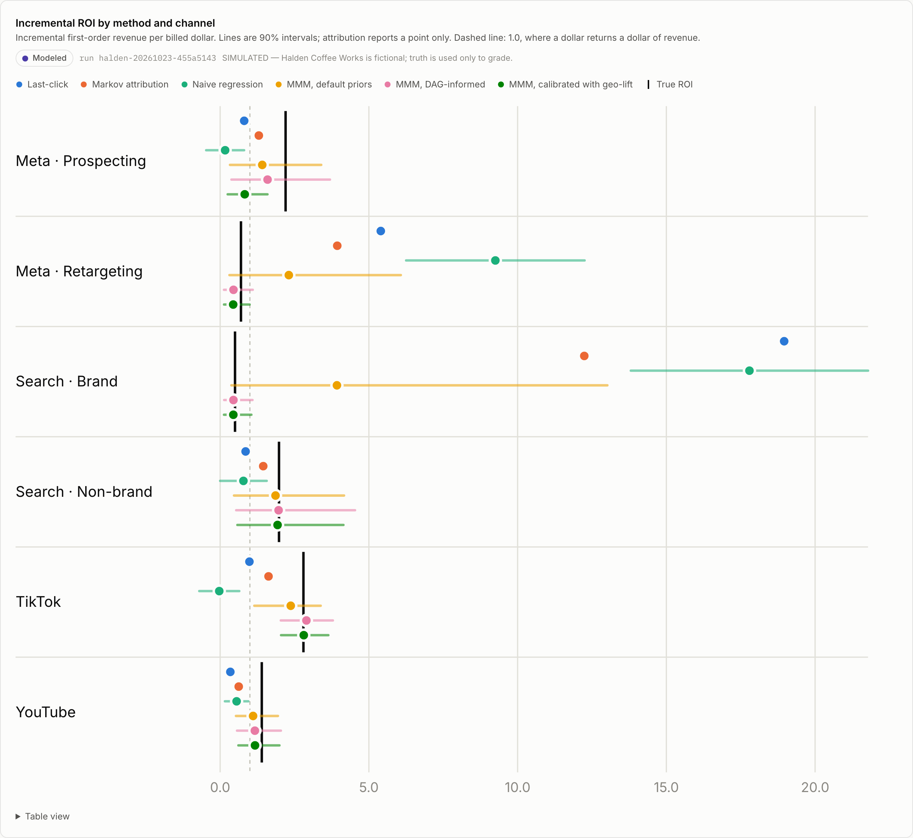
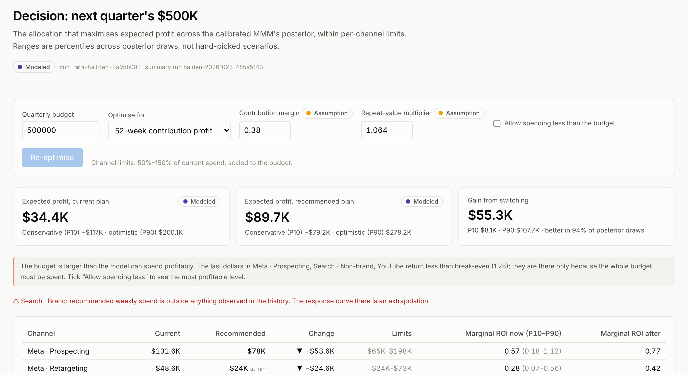

# ATLAS — Marketing measurement you can grade

> I built a company whose causal truth I knew, then measured which marketing-measurement methods
> would have misled me, by how much money, and which experiment would fix it.

Marketing teams don't lack dashboards or models. They lack a way to know **how much to trust each
number**. ATLAS labels every number with its evidence type (Observed · Attributed · Modeled ·
Experimental · Simulated · Assumption) and treats uncertainty as an input to the budget decision.



*Six methods estimate what a dollar of each channel returns, on the same simulated data. The black
tick is the truth. Last-click says Search · Brand returns $19 per dollar; it returns $0.50.*

## What it found

**Halden Coffee Works** is a fictional coffee company (simulated, 156 weeks, 10 regions, 6 paid
channels) whose data-generating process was written down before any model was fit
([spec](docs/data-generating-process.md)). Because the truth is known, every method can be graded.

Across **24 randomized worlds** (four regimes, including ones designed to break MMM;
run `scorecard-24w-9a760623`):

| Method | Mean error in ROI ($ per $) | 90% interval covers truth | Its plan does worse than the current plan |
|---|---|---|---|
| Bayesian MMM, DAG-informed priors, calibrated with one geo-lift | **0.42** | 89% | 8% of worlds |
| Bayesian MMM, DAG-informed priors | 0.46 | 89% | 13% |
| Bayesian MMM, default priors | 1.05 | 83% | 50% |
| Markov attribution | 2.85 | no interval | — |
| Last-click attribution | 4.31 | no interval | 83% |
| Naive regression | 4.55 | 29% | — |

- **Attribution over-credits harvest channels by an order of magnitude** (brand search, retargeting)
  and under-credits prospecting and video. Budgets built on it do worse than simply keeping the
  current plan in 83% of worlds.
- **Priors matter more than the sampler.** Default MMM priors let demand-driven brand search look
  like the best channel. Encoding the causal structure (brand search harvests demand that other
  channels create) halves the error.
- **One geo-lift experiment helps on average but can mislead.** Calibration cut the tested channel's
  error in 79% of worlds. In the flagship world the test landed 2.9 standard errors from the truth
  and made the plan *worse*. ATLAS shows that case instead of hiding it.
- **The $500K question** (flagship world, run `halden-20261023-455a5143`): the recommended plan moves
  money from Meta prospecting, retargeting and brand search into non-brand search and TikTok.
  Expected gain +$55K (P10 +$8K, P90 +$108K). Graded against the truth it earns **+$13K** over the
  current plan, less than the model expected. The model also says the budget is too big: allowed to
  underspend, it would spend about $363K.
- **Next best experiment**: an 8-week Meta prospecting go-dark, ranked by net value (value of
  information minus expected cost). It pays for itself mostly through the spend it saves; its
  power is only ~40%, so a null result would be inconclusive.

**Real data, analysed separately (never blended with the simulation):**

- **Google Merchandise Store (GA4 public sample, observed).** Revenue deduplicated by transaction id:
  **$307,640** (naive sum $362,165). The late-January revenue drop is **instrumentation, not demand**:
  purchase events per session hold steady while the share with a usable transaction id falls from
  92% to 18% (labelled *Supported hypothesis*, since no order database exists to confirm it).
- **Criteo Uplift v2.1 (13.98M users, observed RCT).** Ads raised visits by **+27.1%**
  (95% CI 26.2–28.0%) and conversions by **+59.4%** (54.4–64.7%); randomization checks out
  (sample-ratio p = 0.999). Targeting the top 10% by uplift model yields 6.3× the average lift on
  held-out users.

The change detector, tuned on incident-free worlds and tested on 12 others with 72 injected
incidents, finds **96%** of them; **66%** of its alerts are real (run `anomaly-20261023-d6a9f4ff`).

## Run it

```bash
make demo          # needs uv and Node 20+; fresh clone → http://localhost:3210 in a few minutes
```

or `docker compose up --build` (http://localhost:3000). Model runs are committed, so nothing is
fitted at start-up. To reproduce them: `make models` (~3 min), `make scorecard` (~1–2 h on
10 cores), `make criteo` (downloads 300 MB, deletes it after).



## How it is built

```
 GA4 extracts (BigQuery)    Criteo download        Halden simulator (seeded)
          └───────────────────────┼──────────────────────────┘
          dbt-duckdb: staging → intermediate → marts, with reconciliation tests
                                  │
   Python jobs: attribution · Bayesian MMM (PyMC) · geo-lift · optimizer over posterior draws
                · value of information · uplift models · anomaly engine → model_runs/{run_id}/
                                  │
              FastAPI (read-only; every response carries evidence type + run id)
                                  │
              Next.js 16 · TypeScript · Tailwind · Recharts
```

- **Metric layer** in YAML compiled to SQL, ratios always computed as ratios of sums; every metric is
  checked against an independent computation ([`src/atlas/metrics`](src/atlas/metrics)).
- **MMM** written directly in PyMC (geometric adstock, Hill saturation, ROI-parameterised priors, a
  lift-test likelihood term) so every modelling choice is visible ([`src/atlas/mmm`](src/atlas/mmm)).
- **Optimizer** solves exactly (dynamic programming) over 1,000 posterior draws, flags spend outside
  the observed range, and reports P10/P50/P90 rather than hand-picked scenarios.
- **Tests**: 229 pytest tests (including hypothesis property tests and API contract tests), dbt data
  tests, Vitest, and Playwright at desktop and phone width. CI runs all of them plus the Docker build.

## Limitations

- Halden is simulated. The scorecard shows how methods behave **when their assumptions are roughly
  right**; the fitted MMM's functional forms match the simulator's, which flatters it. Robustness
  runs with mismatched forms are future work.
- 4–21% of scorecard MMM fits (depending on the variant) miss the R-hat < 1.01 bar; they are
  reported, not dropped.
- GA4 covers 92 days with no cost data: no ROAS, CAC, MMM or credible lifetime value there. Its
  acquisition fields describe the user's *first* visit and are labelled as such.
- Criteo features are anonymised and carry no spend or revenue, so it answers "did ads cause
  visits, and for whom?", not "was it profitable?".

## Read more

- [Case study and interview notes](docs/case-study.md)
- [Strategy, scope and roadmap](docs/00-strategy.md)
- [Data-generating process (pre-registered)](docs/data-generating-process.md)
- [Decision log](docs/decisions.md): every non-obvious choice, with the alternatives rejected
- [GA4 extraction and reconciliation](docs/ga4-extraction.md)

Data: GA4 obfuscated sample © Google (BigQuery public dataset). Criteo Uplift v2.1, CC BY-NC-SA 4.0;
raw rows are never committed.
