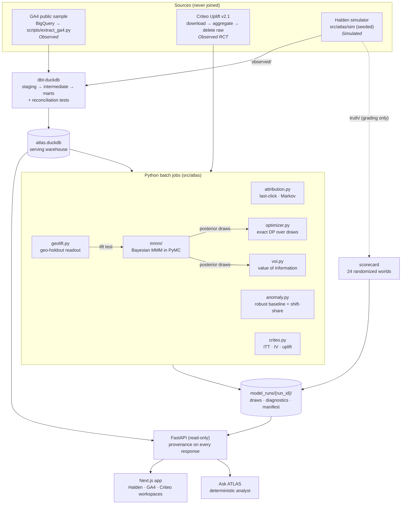
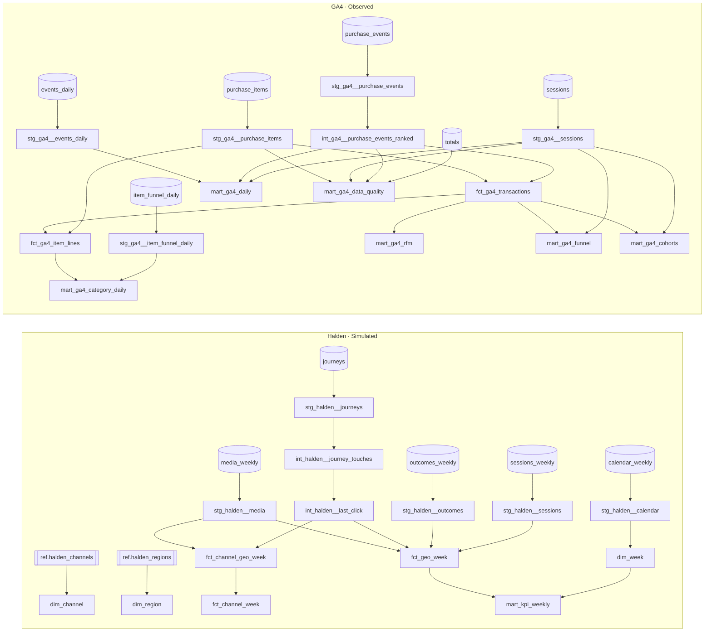

# Architecture and data lineage

ATLAS is a batch-analytics system with a read-only serving layer. Models are fitted offline;
the app serves stored runs, so every number on screen traces to a run id and nothing is
re-estimated on request. The one exception is the optimizer, which re-solves over stored
posterior draws when a control changes.

## System

| Layer | Responsibility | Key guarantee |
|---|---|---|
| Simulator | Generates Halden's observable data and, separately, its causal truth | `truth/` is read only by the scorecard and regret checks |
| dbt | Cleans, deduplicates and models the observable data | Uniqueness, relationship and reconciliation tests gate the build |
| Metric layer | YAML definitions compiled to SQL | Ratios are ratios of sums; each metric is checked against an independent query |
| Batch jobs | Attribution, MMM, experiments, optimization, anomaly detection | Every run writes a manifest (seed, config fingerprint, sampler diagnostics) |
| API | Serves marts and stored runs | Each response carries evidence type, source tables, date range and run id |
| Web | Three workspaces, never blended | A provenance strip on every page shows what kind of evidence is on screen |

## dbt lineage

Generated from `dbt/target/manifest.json`. Sources are on the left, marts on the right.

`int_ga4__purchase_events_ranked` is where the deduplication rule lives (decision D-011): the
earliest purchase event per valid transaction id is kept, and `(not set)`/NULL ids are carried as
*unidentified* rather than silently summed into revenue. `mart_ga4_data_quality` reconciles the
modelled tables back to the extraction totals.

## Model runs

| Run id | What it is |
|---|---|
| `halden-20261023-455a5143` | Flagship Halden decision run: attribution, MMM variants, geo-lift, optimizer, value of information |
| `mmm-halden-dc8353b0` | Bayesian MMM, default priors (ROI ~ LogNormal(0.2, 0.9) for every channel); converged |
| `mmm-halden-8a85883e` | Bayesian MMM, DAG-informed: skeptical ROI prior LogNormal(log 0.35, 0.6) on brand search and retargeting; converged |
| `mmm-halden-6a9bb005` | DAG-informed MMM + lift-test likelihood term for Meta prospecting; converged |
| `scorecard-24w-9a760623` | 24 randomized worlds × methods, graded against truth |
| `anomaly-20261023-d6a9f4ff` | Detector calibrated on 12 incident-free worlds, evaluated on 12 others |
| `criteo-20261023-21b31503` | Criteo RCT readout and uplift models (aggregates only) |

## Reproducing

| Command | Does | Cost |
|---|---|---|
| `make demo` | Runs the app from committed runs | Minutes; no fitting |
| `make build` | Simulator + dbt warehouse + tests | Seconds |
| `make models` | Flagship fits | ~3 min |
| `make scorecard` | 24-world grading | ~1–2 h on 10 cores |
| `make criteo` | Downloads 300 MB, aggregates, deletes the raw file | Network-bound |
| `uv run python scripts/data_dictionary.py` | Regenerates [the data dictionary](data-dictionary.md) | Seconds |
